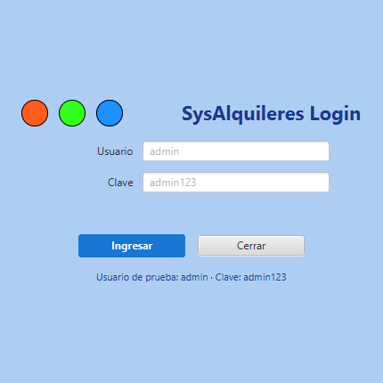
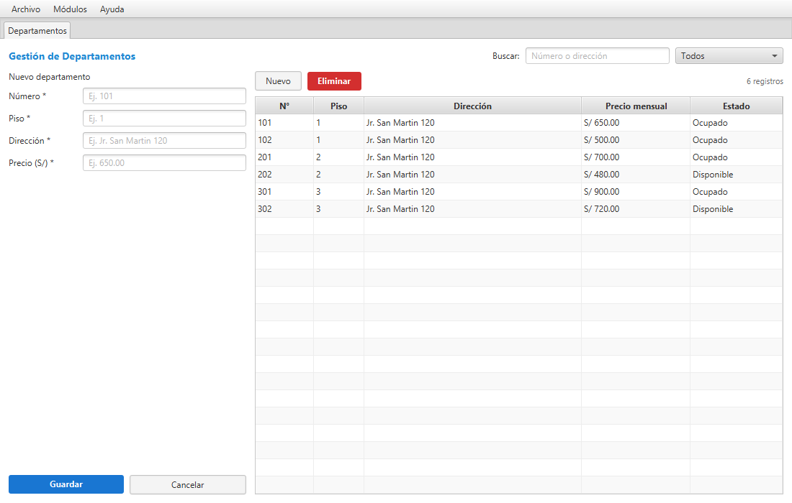

# SysAlquileres · Gestión de Departamentos

Sistema de escritorio para administrar el alquiler de departamentos: departamentos, inquilinos, contratos y pagos. Desarrollado en **Java 21 + JavaFX + FXML** con arquitectura por capas, siguiendo el estilo sencillo del proyecto de referencia del curso **POO 2026 · UPEU Juliaca**.

| Login | Ventana principal |
|---|---|
|  |  |

---

## 1. Funcionalidades

### Login
- Pantalla de acceso al iniciar la aplicación.
- Validación real contra la tabla `usuario` de la base de datos.
- Mensaje de error si el usuario o la clave no son correctos.
- Credenciales de prueba: **admin / admin123**.

### Ventana principal
- Barra de menú: **Archivo** (cerrar sesión, salir), **Módulos** y **Ayuda**.
- Pestañas para cada módulo; se abren una sola vez y se reutilizan.
- Encabezado con el nombre del usuario autenticado y barra de estado con el módulo y la fecha.
- Cada módulo muestra el **formulario a la izquierda** y la **tabla a la derecha**.

### Departamentos
- Listado con búsqueda por número o dirección y filtro por estado.
- Registro y edición desde el formulario; al seleccionar una fila se cargan sus datos.
- Eliminación con confirmación; se bloquea si el departamento tiene contratos asociados.
- Estados: `Disponible` y `Ocupado`. El estado cambia automáticamente al crear o finalizar un contrato.

### Inquilinos
- Búsqueda por DNI, nombre o apellido y filtro por tipo de personería.
- Validación de **DNI único de 8 dígitos numéricos**.
- Personería **Natural** o **Jurídica**; para la jurídica se habilitan representante legal, RUC (10–11 dígitos) y dirección fiscal.
- Eliminación bloqueada si el inquilino tiene contratos.

### Contratos
- Registro de contrato con inquilino, departamento, fechas, monto mensual y cantidad de personas.
- **Regla de negocio:** un departamento no puede tener dos contratos vigentes con fechas superpuestas.
- Validación de fechas: la fecha de fin debe ser posterior a la de inicio.
- Finalización con motivo (`Fin de plazo`, `Rescisión`, `Incumplimiento`, `Mutuo acuerdo`), liberando el departamento.
- No se pueden editar ni eliminar contratos finalizados; tampoco eliminar contratos con pagos.

### Pagos
- Registro de pagos asociados a un contrato, con periodo, método, descuento e IGV.
- Búsqueda por inquilino, departamento o periodo y filtro por método de pago.
- Edición y eliminación con confirmación.
- Métodos: Efectivo, Transferencia, Yape, Plin, Tarjeta.

---

## 2. Arquitectura

```
src/main/java/pe/edu/upeu/alquileres
├── App.java                     # Punto de entrada: login → ventana principal
├── components/                  # Diálogos de confirmación y aviso
├── config/
│   ├── AppContext.java          # Contenedor de dependencias (repos + servicios + controladores)
│   └── DatabaseConfig.java      # HikariCP, creación del esquema y seed
├── controller/                  # Login, ventana principal y controladores de cada módulo
├── enums/                       # EstadoDepartamento, EstadoContrato, MetodoPago
├── exception/                   # BusinessException
├── model/                       # Usuario, Departamento, Inquilino, TipoPersoneria, Contrato, Pago...
├── repository/                  # Interfaces + AbstractJpaRepository (JDBC)
├── service/                     # Interfaces + implementaciones con reglas de negocio
└── util/                        # Formato, Sesion y Validador (Jakarta Validation)
```

Flujo de una operación:

```
FXML → Controller → Service (valida reglas) → Repository (JDBC) → Base de datos
```

Las dependencias se crean una sola vez en `AppContext`; los controladores se inyectan con `loader.setControllerFactory(context::getBean)`.

---

## 3. Requisitos

| Herramienta | Versión |
|---|---|
| JDK | 21 |
| Maven | 3.9+ |
| JavaFX | 21.0.6 (se descarga con Maven) |
| Base de datos | H2 embebida (por defecto) o PostgreSQL 14+ |

No es necesario instalar JavaFX ni H2 por separado: Maven resuelve las dependencias.

---

## 4. Ejecución

Desde la carpeta `SysAlquileres`:

```bash
mvn javafx:run
```

En Windows, si `mvn` no está en el PATH:

```powershell
mvn.cmd -B javafx:run
```

También se puede ejecutar desde IntelliJ con el botón verde **Run** sobre `App` o sobre `SysAlquileres`. La clase `App` no extiende `Application` directamente (la ventana JavaFX está en la clase interna `App.Ventana`), justamente para evitar el error *"JavaFX runtime components are missing"*.

Compilar y empaquetar:

```bash
mvn -B -DskipTests package
```

La primera ejecución crea la base en `data/alquileres.mv.db`, ejecuta `schema.sql` y carga `seed.sql`.

Al iniciar aparece el **login**; ingresa con el usuario `admin` y la clave `admin123`.

### Credenciales H2 por defecto

| Parámetro | Valor |
|---|---|
| URL | `jdbc:h2:file:./data/alquileres;MODE=PostgreSQL;DATABASE_TO_LOWER=TRUE` |
| Usuario | `sa` |
| Contraseña | *(vacía)* |

Para reiniciar la base de datos: cierra la aplicación y elimina la carpeta `data/`. Al volver a iniciar se recrea con los datos de ejemplo, incluido el usuario `admin`.

> Si actualizas desde una versión anterior, elimina la carpeta `data/` una vez: las bases ya creadas no reciben automáticamente la tabla `usuario`.

---

## 5. Uso con PostgreSQL

1. Crear la base:

   ```sql
   CREATE DATABASE alquileres;
   ```

2. Ejecutar el script incluido:

   ```bash
   psql -U postgres -d alquileres -f database/postgresql_sistema_alquileres.sql
   ```

   El script crea tablas, restricciones (`CHECK`, claves foráneas, exclusión de solapamiento con `btree_gist`), índices, vistas y los datos de ejemplo (incluido el usuario `admin`).

3. Editar `src/main/resources/application.properties`:

   ```properties
   db.url=jdbc:postgresql://localhost:5432/alquileres
   db.username=postgres
   db.password=postgres
   db.ddl.auto=false
   db.seed.demo=false
   ```

4. Ejecutar de nuevo con `mvn javafx:run`.

---

## 6. Modelo de datos

| Tabla | Descripción |
|---|---|
| `usuario` | Usuario, clave, nombre, rol y estado para el login |
| `tipo_personeria` | Natural / Jurídica |
| `departamento` | Número, piso, dirección, precio mensual y estado |
| `inquilino` | DNI único, datos personales y datos de personería jurídica |
| `contrato` | Fechas, monto, estado, inquilino y departamento |
| `pago` | Fecha, periodo, monto, método, descuento e IGV |
| `finalizacion_contrato` | Fecha y motivo de finalización |

Relaciones principales:

```
departamento 1 ─── N contrato N ─── 1 inquilino
                      │
                      1
                      │
                      N
                    pago

usuario (independiente, solo autenticación)
```

Restricciones destacadas:

- `usuario.usuario` único; el login solo acepta usuarios con estado `Activo`.
- `inquilino.dni` único y de 8 dígitos.
- `departamento.numero` único.
- `contrato.fecha_fin > contrato.fecha_inicio`.
- En PostgreSQL, `EXCLUDE USING gist` impide contratos vigentes superpuestos para un mismo departamento.
- `pago.idcontrato` obligatorio: todo pago pertenece a un contrato.

---

## 7. Datos de ejemplo

| Módulo | Registros |
|---|---|
| Usuarios | 1 (`admin` / `admin123`) |
| Departamentos | 6 (101, 102, 201, 202, 301, 302) |
| Inquilinos | 5 |
| Contratos | 5 (4 vigentes, 1 finalizado) |
| Pagos | 8 |

---

## 8. Estructura del proyecto

```
SysAlquileres/
├── database/
│   └── postgresql_sistema_alquileres.sql
├── docs/screenshots/
├── src/main/java/pe/edu/upeu/alquileres/
├── src/main/resources/
│   ├── application.properties
│   ├── logback.xml
│   ├── schema.sql
│   ├── seed.sql
│   ├── css/app.css
│   └── view/
│       ├── login.fxml
│       ├── main.fxml
│       ├── departamentos.fxml
│       ├── inquilinos.fxml
│       ├── contratos.fxml
│       └── pagos.fxml
├── data/                        # Base H2 (se genera al ejecutar)
└── pom.xml
```

---

## 9. Notas

- La aplicación usa H2 en modo PostgreSQL para que funcione sin instalación adicional; el script de PostgreSQL queda disponible para el despliegue descrito en el informe.
- La clave del usuario se guarda en texto plano para mantener el ejemplo académico simple; en un sistema real debe almacenarse con hash (por ejemplo, BCrypt).
- Los formularios validan en el servicio y muestran los errores con `BusinessException` en una etiqueta del formulario, sin cerrar la pantalla.
- Las confirmaciones de eliminación y finalización usan diálogos simples (`Dialogos`).
- El proyecto no usa `module-info.java`; se ejecuta en classpath mediante `javafx-maven-plugin`.
