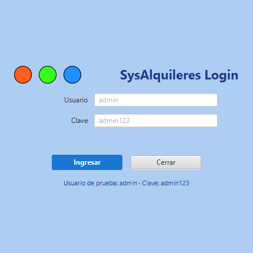
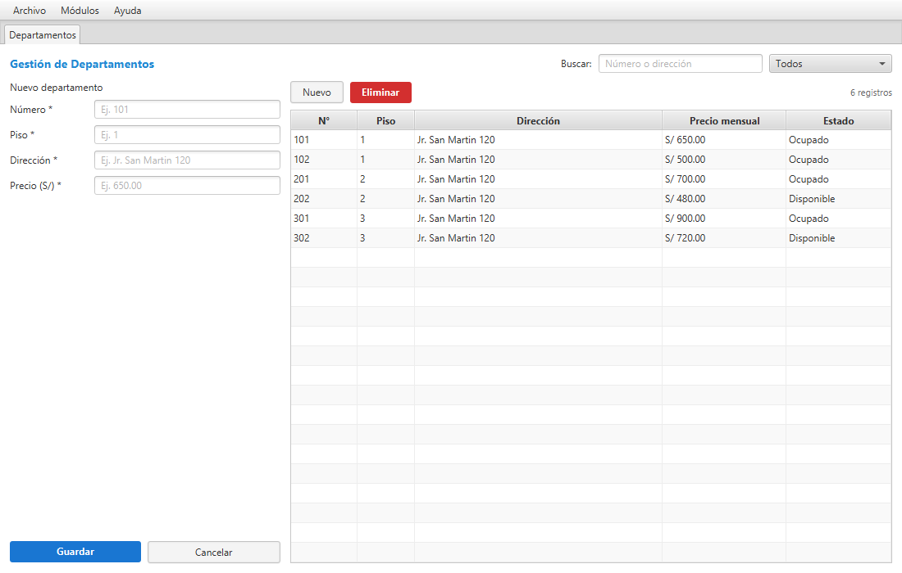

# Guía de exposición y estudio — SysAlquileres

> **Cómo usar esta guía:** lee las secciones 1 a 4 para entender el sistema, la 5 para conocer el código, la 8 para practicar la exposición y la 9 para prepararte para las preguntas del profesor. No necesitas memorizar todo: concéntrate en explicar el flujo y las reglas de negocio con tus propias palabras.

---

## 1. ¿Qué es SysAlquileres?

SysAlquileres es una aplicación de escritorio para administrar el alquiler de departamentos. Permite guardar departamentos, inquilinos, contratos y pagos, y aplica reglas de negocio para que la información no se contradiga.

**Problema que resuelve:** llevar estos datos en cuadernos u hojas de cálculo provoca errores: un departamento alquilado dos veces, pagos sin contrato, inquilinos duplicados o contratos con fechas incorrectas. El sistema centraliza la información y valida esas situaciones.

**Módulos:**

| Módulo | Para qué sirve |
|---|---|
| Login | Identifica al usuario antes de entrar |
| Departamentos | Registra número, piso, dirección, precio y estado |
| Inquilinos | Registra personas naturales o empresas |
| Contratos | Relaciona un inquilino con un departamento y unas fechas |
| Pagos | Registra los pagos mensuales de cada contrato |

**Tecnologías:** Java 21, JavaFX 21, FXML, Maven, H2 (base embebida por defecto), PostgreSQL (opcional), JDBC con HikariCP, Jakarta Validation y Lombok.

**Credenciales de prueba:** usuario `admin`, clave `admin123`.





---

## 2. Cómo ejecutar el sistema

**Requisitos:** JDK 21 y Maven 3.9 o superior.

```powershell
cd "D:\CRUD DEPARTAMENTOS\SysAlquileres"
mvn.cmd -B javafx:run
```

La primera vez se crea la carpeta `data/` con la base H2, se ejecuta `schema.sql` y se cargan los datos de `seed.sql`.

**Para reiniciar la base de datos:** cierra la aplicación, elimina la carpeta `data/` y vuelve a ejecutar. Se crea de nuevo con los datos de ejemplo y el usuario `admin`.

**Si actualizaste desde una versión anterior:** elimina `data/` una vez, porque una base ya creada no recibe automáticamente la tabla `usuario`.

---

## 3. Estructura del proyecto

```text
SysAlquileres/
├── database/
│   └── postgresql_sistema_alquileres.sql   Script completo para PostgreSQL
├── docs/
│   ├── GUIA_EXPOSICION.md                  Esta guía
│   ├── GUIA_EXPOSICION.html                Versión imprimible
│   └── screenshots/                        Capturas del sistema
├── src/main/java/pe/edu/upeu/alquileres/
│   ├── App.java                            Inicio: login y ventana principal
│   ├── components/Dialogos.java            Confirmaciones y avisos
│   ├── config/AppContext.java              Crea y conecta objetos
│   ├── config/DatabaseConfig.java          Conexión, esquema y seed
│   ├── controller/                         Controladores de las vistas
│   ├── enums/                              Estados y métodos de pago
│   ├── exception/BusinessException.java    Errores de negocio
│   ├── model/                              Clases de datos
│   ├── repository/                         Acceso a la base de datos
│   ├── service/                            Reglas de negocio
│   └── util/                               Formato, Sesion, Validador
├── src/main/resources/
│   ├── application.properties              Configuración de la base
│   ├── schema.sql                          Creación de tablas
│   ├── seed.sql                            Datos de ejemplo
│   ├── css/app.css                         Estilos
│   └── view/                               Archivos FXML
│       ├── login.fxml
│       ├── main.fxml
│       ├── departamentos.fxml
│       ├── inquilinos.fxml
│       ├── contratos.fxml
│       └── pagos.fxml
└── pom.xml                                 Dependencias y configuración Maven
```

### ¿Dónde tocar si quieres cambiar algo?

| Quiero cambiar... | Archivo |
|---|---|
| El aspecto visual | `src/main/resources/css/app.css` |
| La distribución de una pantalla | `src/main/resources/view/*.fxml` |
| Lo que hace un botón | `src/main/java/.../controller/*.java` |
| Una regla de negocio | `src/main/java/.../service/impl/*.java` |
| Una consulta SQL | `src/main/java/.../repository/*.java` |
| Un campo de una tabla | `src/main/resources/schema.sql` y el modelo |

---

## 4. Arquitectura por capas

El proyecto está dividido en capas. Cada capa tiene una responsabilidad y se comunica con la siguiente:

```text
FXML (pantalla)
   ↓
Controller (recibe los clics)
   ↓
Service (valida las reglas de negocio)
   ↓
Repository (ejecuta SQL)
   ↓
Base de datos (H2 o PostgreSQL)
```

| Capa | Responsabilidad | Ejemplo |
|---|---|---|
| Vista (FXML) | Muestra controles y define su distribución | `departamentos.fxml` |
| Controller | Escucha botones, lee campos y actualiza la tabla | `DepartamentoController` |
| Service | Valida y aplica reglas antes de guardar | `DepartamentoServiceImp` |
| Repository | Traduce objetos a SQL | `DepartamentoRepository` |
| Model | Representa los datos | `Departamento`, `Contrato` |
| Config / Util | Conexión, dependencias y ayudas | `AppContext`, `Formato` |

**¿Por qué separar así?** Porque si mañana cambia la base de datos, solo se modifica el repository. Si cambia una regla, solo el service. Si cambia la pantalla, solo el FXML y el controller. Además, el código es más fácil de leer y de probar.

Es normal que este proyecto tenga más archivos que un ejemplo de una sola clase: cada archivo tiene una tarea concreta. En la exposición puedes explicarlo así: “separé el proyecto en capas para que cada clase tenga una sola responsabilidad”.

### Flujo completo al guardar un departamento

1. El usuario llena los campos y presiona **Guardar**.
2. `departamentos.fxml` llama al método `onGuardar()` del `DepartamentoController`.
3. El controller arma un objeto `Departamento` con los datos de los campos.
4. Llama a `departamentoService.save(departamento)`.
5. El service limpia los textos, valida con Jakarta Validation, comprueba que el número no esté repetido y guarda.
6. El repository ejecuta un `INSERT` con `PreparedStatement`.
7. El controller vuelve a cargar la tabla con `cargar()` y limpia el formulario.

---

## 5. Recorrido del código

### 5.1 App.java — el punto de entrada

`App` es la clase que arranca el programa. Tiene el método `main`, que llama a `Application.launch(...)` para iniciar JavaFX.

La ventana JavaFX está en una clase interna llamada `Ventana`, que sí extiende `Application`:

```java
public class App {

    public static class Ventana extends Application {
        @Override
        public void start(Stage stage) {
            ventana = stage;
            AppContext.getInstance();
            mostrarLogin();
        }

        @Override
        public void stop() {
            DatabaseConfig.shutdown();
        }
    }

    public static void main(String[] args) {
        Application.launch(Ventana.class, args);
    }
}
```

**¿Por qué `App` no extiende `Application` directamente?** Porque Java bloquea el arranque desde el botón **Run** del IDE con el error *"JavaFX runtime components are missing"*. Al dejar el `main` en una clase normal y poner la ventana en una clase interna, el botón verde funciona sin configurar nada. También existe `SysAlquileres.java`, un lanzador que solo llama a `App.main(args)`.

- `AppContext.getInstance()` crea una sola vez los repositorios, servicios y controladores.
- `mostrarLogin()` carga `login.fxml`.
- `mostrarPrincipal()` carga `main.fxml` después de un login correcto.
- `cargar(...)` crea la escena, aplica `app.css` y muestra la ventana.
- `stop()` cierra el pool de conexiones cuando se cierra la aplicación.

### 5.2 Login

La pantalla `login.fxml` tiene dos campos (`txtUsuario`, `txtClave`), un botón **Ingresar**, un botón **Cerrar** y una etiqueta para el error.

El botón está conectado con `onAction="#onIngresar"`. Eso significa: “cuando hagan clic, ejecuta el método `onIngresar` del controlador”.

```java
@FXML
private void onIngresar() {
    lblError.setText("");
    try {
        Optional<Usuario> usuario = service.login(txtUsuario.getText(), txtClave.getText());
        if (usuario.isEmpty()) {
            lblError.setText("Usuario o clave incorrectos.");
            txtClave.clear();
            txtClave.requestFocus();
            return;
        }
        Sesion.iniciar(usuario.get());
        App.mostrarPrincipal();
    } catch (BusinessException e) {
        lblError.setText(e.getMessage());
    }
}
```

Flujo del login:

1. El controller llama a `IUsuarioService.login(usuario, clave)`.
2. El servicio valida que los campos no estén vacíos.
3. `UsuarioRepository` ejecuta:

   ```sql
   SELECT * FROM usuario
   WHERE usuario = ? AND clave = ? AND estado = 'Activo'
   ```

4. Si hay coincidencia, devuelve un `Optional<Usuario>` con el usuario.
5. `Sesion.iniciar(...)` guarda el usuario en memoria.
6. `App.mostrarPrincipal()` abre la ventana principal.
7. Si no hay coincidencia, se muestra “Usuario o clave incorrectos”.

**Importante:** la clave está en texto plano porque es un proyecto académico. En un sistema real se guardaría un hash (por ejemplo, BCrypt).

### 5.3 Ventana principal

`main.fxml` contiene un `MenuBar` y un `TabPane`. El menú tiene **Archivo**, **Módulos** y **Ayuda**.

`MainController` abre una pestaña nueva solo si aún no existe:

```java
private void abrirTab(String clave) {
    for (Tab tab : tabPane.getTabs()) {
        if (clave.equals(tab.getUserData())) {
            tabPane.getSelectionModel().select(tab);
            return;
        }
    }
    // si no existe, carga el FXML y crea la pestaña
    FXMLLoader loader = new FXMLLoader(getClass().getResource("/view/" + vista.archivo()));
    loader.setControllerFactory(AppContext.getInstance()::getBean);
    Parent root = loader.load();
    Tab tab = new Tab(vista.titulo(), root);
    tab.setUserData(clave);
    tabPane.getTabs().add(tab);
    tabPane.getSelectionModel().select(tab);
}
```

`setControllerFactory(...)` le dice a JavaFX: “cuando el FXML necesite un controlador, pídeselo a `AppContext`”. Así el controlador recibe sus servicios ya creados.

### 5.4 Un módulo completo: Departamentos

La pantalla tiene tres partes:

1. Barra superior: título, buscador y filtro por estado.
2. Formulario: número, piso, dirección y precio.
3. Tabla: número, piso, dirección, precio y estado.

**Columnas de la tabla.** En `initialize()` se indica de qué propiedad del modelo sale cada columna:

```java
colNumero.setCellValueFactory(new PropertyValueFactory<>("numero"));
colPiso.setCellValueFactory(new PropertyValueFactory<>("piso"));
colDireccion.setCellValueFactory(new PropertyValueFactory<>("direccion"));
colPrecio.setCellValueFactory(new PropertyValueFactory<>("precioMensual"));
colEstado.setCellValueFactory(new PropertyValueFactory<>("estado"));
```

**Filtro.** Se usa un `FilteredList`, que envuelve la lista original y muestra solo los elementos que cumplen una condición:

```java
filtrados = new FilteredList<>(datos, d -> true);
tblDepartamentos.setItems(filtrados);

txtBuscar.textProperty().addListener((o, anterior, actual) -> aplicarFiltro());
```

**Guardar o actualizar.** Si `idEditando` es `null`, es un registro nuevo; si tiene valor, se está editando la fila seleccionada:

```java
if (idEditando == null) {
    service.save(departamento);
} else {
    service.update(idEditando, departamento);
}
```

**Eliminar.** Primero se pide confirmación y luego se llama al service. El service impide eliminar un departamento con contratos:

```java
if (contratoRepository.existsByDepartamento(id)) {
    throw new BusinessException(
        "No se puede eliminar el departamento porque tiene contratos registrados.");
}
```

**Estados.** Un departamento es `Disponible` u `Ocupado`. Al crear un contrato, el service lo marca `Ocupado`; al finalizar el contrato, vuelve a `Disponible`.

### 5.5 Inquilinos

Un inquilino puede ser **persona natural** o **persona jurídica** (empresa).

- Natural: DNI de 8 dígitos, nombre y apellido.
- Jurídica: además, representante legal, RUC de 10 u 11 dígitos y dirección fiscal.

El controller muestra los campos legales solo cuando se elige “Jurídica”:

```java
boolean esJuridica = tipo != null && "Jurídica".equalsIgnoreCase(tipo.getNombre());
boxLegal.setVisible(esJuridica);
boxLegal.setManaged(esJuridica);
```

`setManaged(false)` hace que el contenedor no ocupe espacio cuando está oculto.

El service valida que el DNI tenga 8 dígitos y que no esté repetido.

### 5.6 Contratos

Un contrato une un inquilino con un departamento durante un periodo. Reglas principales:

- La fecha de fin debe ser posterior a la fecha de inicio.
- Un departamento no puede tener dos contratos vigentes con fechas que se crucen.
- Al crear el contrato, el departamento pasa a `Ocupado`.
- Al finalizar, se guarda el motivo y el departamento vuelve a `Disponible`.
- Un contrato finalizado no se puede editar ni eliminar.
- Un contrato con pagos tampoco se puede eliminar.

La validación de superposición está en `ContratoServiceImp`:

```java
repository.findVigenteSuperpuesto(
        idDepartamento, contrato.getFechaInicio(), contrato.getFechaFin(), excluirId)
    .ifPresent(c -> {
        throw new BusinessException(
            "El departamento ya tiene un contrato vigente que se cruza con esas fechas.");
    });
```

### 5.7 Pagos

Cada pago pertenece a un contrato. Se registra la fecha de pago, el periodo, el monto, el método, el descuento y el IGV.

El servicio normaliza el periodo al primer día del mes:

```java
if (pago.getPeriodo() != null) {
    pago.setPeriodo(pago.getPeriodo().withDayOfMonth(1));
}
```

También valida que el descuento y el IGV no sean negativos, y que el monto sea mayor a cero.

---

## 6. Conceptos de Java y JavaFX usados

### Java

- **Clase:** plantilla para crear objetos. Ejemplo: `Departamento`.
- **Objeto:** un departamento concreto en memoria.
- **Atributo:** dato de la clase (`numero`, `precioMensual`).
- **Método:** acción de la clase (`save`, `findAll`).
- **Constructor:** método que crea el objeto y recibe sus dependencias.
- **Encapsulamiento:** los atributos son `private` y se acceden con getters y setters.
- **Herencia:** `DepartamentoRepository` hereda de `AbstractJpaRepository`, que ya tiene `save`, `update`, `delete` y `findById`.
- **Interfaz:** define el contrato de un servicio (`IDepartamentoService`). La implementación (`DepartamentoServiceImp`) es la que tiene el código.
- **Polimorfismo:** el controller usa la interfaz; no necesita saber qué implementación exacta está detrás.
- **Enum:** valores fijos. Ejemplo: `EstadoDepartamento.DISPONIBLE` y `OCUPADO`.
- **Lombok:** genera getters, setters, constructores y el builder con anotaciones como `@Data` y `@Builder`.
- **BigDecimal:** se usa para dinero porque evita errores de redondeo de `double`.
- **LocalDate:** representa una fecha sin hora (fecha de inicio, fecha de pago).
- **Optional:** representa un valor que puede existir o no. Se usa cuando se busca un registro por ID.
- **Excepción:** un error controlado. `BusinessException` lleva un mensaje que se muestra al usuario.
- **List:** colección ordenada de elementos.
- **Map:** colección de pares clave-valor. Se usa en `MainController` para relacionar el nombre del módulo con su FXML.
- **Record:** clase corta para agrupar datos. `Vista(String archivo, String titulo)` es un record.
- **Lambda:** función corta. Ejemplo: `d -> d.getEstado() == EstadoDepartamento.DISPONIBLE`.
- **Stream:** recorre y filtra colecciones de forma expresiva.

### JavaFX

- **Stage:** la ventana.
- **Scene:** el contenido de la ventana.
- **FXML:** archivo XML que describe la pantalla.
- **@FXML:** conecta un campo o método de Java con un componente del FXML.
- **FXMLLoader:** lee el FXML y crea los objetos.
- **Controller factory:** indica cómo crear el controlador y pasarle sus dependencias.
- **onAction:** evento que se ejecuta al presionar un botón.
- **Listener:** código que reacciona a un cambio, por ejemplo cuando se escribe en el buscador.
- **ObservableList:** lista que avisa a la tabla cuando cambia.
- **TableView:** componente de tabla.
- **PropertyValueFactory:** indica qué propiedad del objeto se muestra en una columna.
- **FilteredList:** lista filtrada que se conecta a la tabla.
- **styleClass:** clase CSS aplicada a un control.
- **CSS:** archivo `app.css` con colores, tamaños y márgenes.

### Base de datos y persistencia

- **JDBC:** API de Java para hablar con bases de datos.
- **Connection:** conexión abierta.
- **PreparedStatement:** consulta con parámetros `?`. Evita inyección SQL.
- **ResultSet:** resultado de una consulta; se recorre fila por fila.
- **Transacción:** grupo de operaciones que se confirman juntas con `commit()` o se deshacen con `rollback()`.
- **HikariCP:** pool que reutiliza conexiones para no abrir una nueva en cada consulta.
- **H2:** base de datos embebida, no requiere instalación.
- **PostgreSQL:** base de datos cliente-servidor, disponible como opción.
- **Jakarta Validation:** anotaciones como `@NotBlank`, `@NotNull`, `@Size` y `@Pattern` para validar modelos.

---

## 7. Base de datos

### Tablas

| Tabla | Campos principales |
|---|---|
| `usuario` | usuario, clave, nombre, rol, estado |
| `tipo_personeria` | Natural / Jurídica |
| `departamento` | numero, piso, direccion, precio_mensual, estado |
| `inquilino` | dni, nombre, apellido, teléfono, dirección, tipo, RUC |
| `contrato` | fechas, monto, estado, inquilino, departamento |
| `pago` | fecha, periodo, monto, método, descuento, IGV, contrato |
| `finalizacion_contrato` | contrato, fecha, motivo |

### Relaciones

```text
departamento 1 ─── N contrato N ─── 1 inquilino
                      │
                      1
                      │
                      N
                    pago

usuario (independiente, solo para el login)
```

### Esquema y datos iniciales

- `schema.sql` crea las tablas si no existen.
- `seed.sql` inserta los datos de ejemplo y el usuario `admin`.
- `DatabaseConfig.seedIfEmpty()` carga el seed solo si la tabla `inquilino` está vacía.

### ¿H2 o PostgreSQL?

Por defecto se usa H2 en modo PostgreSQL para que el proyecto funcione sin instalar nada. El script `database/postgresql_sistema_alquileres.sql` sirve para ejecutar el mismo sistema con PostgreSQL; solo se cambia `application.properties`.

---

## 8. Guion de exposición (10 a 12 minutos)

### Antes de empezar

- Ejecuta el sistema y verifica que el login funcione con `admin / admin123`.
- Ten datos de ejemplo cargados.
- Abre la carpeta del proyecto en el editor, pero no leas el código durante la demo.
- Ten esta guía a mano por si olvidas un detalle.

### Minuto 0: saludo y objetivo (30 segundos)

> “Buenos días. Voy a presentar SysAlquileres, un sistema de escritorio para administrar el alquiler de departamentos. Permite registrar departamentos, inquilinos, contratos y pagos, y valida reglas para evitar información contradictoria.”

### Minuto 0:30: problema y solución (1 minuto)

> “Cuando se lleva el alquiler en cuadernos o Excel es fácil alquilar dos veces el mismo departamento o registrar un pago sin contrato. El sistema centraliza los datos y aplica reglas de negocio.”

Muestra la ventana principal y enumera los cuatro módulos.

### Minuto 1:30: login (1 minuto)

1. Abre el sistema.
2. Escribe una clave incorrecta y muestra el mensaje de error.
3. Ingresa con `admin / admin123`.
4. Explica: “El login consulta la tabla `usuario`; si las credenciales son correctas, guarda el usuario en `Sesion` y abre la ventana principal”.

### Minuto 2:30: ventana principal (1 minuto)

- Muestra el menú **Archivo**, **Módulos** y **Ayuda**.
- Abre dos pestañas y explica que se reutilizan.
- Cierra sesión y vuelve a entrar para mostrar el flujo completo.

### Minuto 3:30: Departamentos (2 minutos)

1. Registra un departamento nuevo.
2. Muéstralo en la tabla.
3. Selecciónalo, cambia el precio y guarda.
4. Usa el buscador y el filtro.
5. Intenta eliminar un departamento con contrato y explica por qué el sistema lo impide.

### Minuto 5:30: Inquilinos (1.5 minutos)

1. Registra una persona natural.
2. Muestra que el DNI debe tener 8 dígitos.
3. Cambia a persona jurídica y muestra los campos adicionales.
4. Explica que el DNI no se puede repetir.

### Minuto 7: Contratos (2 minutos)

1. Crea un contrato con un inquilino y un departamento disponible.
2. Muestra que el departamento pasa a `Ocupado`.
3. Intenta crear otro contrato con fechas cruzadas y muestra el error.
4. Finaliza el contrato y muestra que el departamento vuelve a `Disponible`.

### Minuto 9: Pagos (1.5 minutos)

1. Registra un pago para un contrato.
2. Muestra el periodo, el método y el monto.
3. Filtra por método de pago.
4. Explica que todo pago debe pertenecer a un contrato.

### Minuto 10:30: arquitectura (1.5 minutos)

Dibuja o muestra este esquema:

```text
FXML → Controller → Service → Repository → Base de datos
```

> “Separé el proyecto en capas: la vista muestra, el controller recibe los eventos, el service valida las reglas y el repository ejecuta el SQL. Así cada clase tiene una responsabilidad.”

Menciona un ejemplo: “Al guardar un departamento, el controller arma el objeto, el service valida el número único y el repository hace el INSERT”.

### Minuto 12: cierre (30 segundos)

> “El sistema permite administrar los cuatro módulos con validaciones. Lo más importante que aprendí fue separar responsabilidades y aplicar reglas de negocio antes de guardar. Como mejora futura se podría agregar encriptación de contraseñas y reportes.”

---

## 9. Preguntas probables del profesor

**¿Por qué usaste capas?**
Para separar responsabilidades: la vista no sabe SQL, el repository no sabe de botones y el service concentra las reglas. Así el código es más fácil de mantener y explicar.

**¿Dónde está la lógica de negocio?**
En los `service/impl`. Por ejemplo, `ContratoServiceImp` valida fechas, superposición y estado del departamento.

**¿Qué pasa si dos contratos se cruzan?**
El service busca un contrato vigente del mismo departamento con fechas superpuestas y lanza una `BusinessException` con un mensaje. La operación no se guarda.

**¿Cómo evitas la inyección SQL?**
Todas las consultas usan `PreparedStatement` con parámetros `?`; no se concatenan los datos del usuario en el SQL.

**¿Por qué usas BigDecimal para el dinero?**
Porque `double` puede producir errores de redondeo. `BigDecimal` es más preciso para montos.

**¿Qué es FXML?**
Un archivo XML que describe la pantalla. JavaFX lo carga con `FXMLLoader` y lo conecta con un controlador mediante `fx:controller`.

**¿Cómo se conecta un botón con el código?**
Con `onAction="#metodo"` en el FXML y un método anotado con `@FXML` en el controlador.

**¿Qué es AppContext?**
Un contenedor de dependencias hecho a mano. Crea una sola vez los repositorios, servicios y controladores, y los entrega cuando se cargan los FXML.

**¿Dónde usas herencia?**
`DepartamentoRepository` hereda de `AbstractJpaRepository`, que ya implementa las operaciones CRUD comunes. Cada repository solo define su tabla, su clave y cómo convertir una fila en objeto.

**¿Dónde usas interfaces?**
En los servicios: `IDepartamentoService`, `IContratoService`, `IPagoService`, `IInquilinoService`, `IUsuarioService`. El controller depende de la interfaz, no de la implementación.

**¿Cómo validas los datos?**
Con anotaciones de Jakarta Validation en los modelos (`@NotBlank`, `@Pattern`, `@NotNull`, `@DecimalMin`) y con `Validador.validar(...)` en los servicios. Las reglas que dependen de la base se validan en el service.

**¿Qué pasa si elimino un departamento con contratos?**
El service lo impide y muestra un mensaje. Primero se deben eliminar o finalizar los contratos.

**¿Cómo cambia el estado de un departamento?**
Al crear un contrato, `ContratoServiceImp` actualiza el departamento a `Ocupado`. Al finalizar o eliminar el contrato, si ya no quedan contratos vigentes, vuelve a `Disponible`.

**¿Por qué la clave está en texto plano?**
Porque es un proyecto académico y así se puede mostrar el flujo con claridad. En producción se debe usar un hash con salt (por ejemplo, BCrypt).

**¿Qué diferencia hay entre H2 y PostgreSQL?**
H2 es embebida y no requiere instalación; PostgreSQL es un servidor y se usa en entornos reales. El proyecto soporta ambos cambiando la configuración.

**¿Qué mejorarías?**
Encriptar claves, agregar reportes en PDF, registrar auditoría de cambios, separar la configuración en variables de entorno y agregar pruebas automatizadas.

**¿Qué fue lo más difícil?**
Se puede responder con honestidad: “Entender cómo se conectan el FXML, el controlador y el servicio, y cómo mantener actualizado el estado del departamento al crear o finalizar contratos”.

**¿Qué aprendiste?**
A organizar un proyecto por capas, usar JavaFX con FXML, aplicar validaciones, trabajar con JDBC y modelar reglas de negocio.

---

## 10. Problemas comunes y soluciones

| Problema | Solución |
|---|---|
| "JavaFX runtime components are missing" | Ejecutar con el botón **Run** sobre `App` o `SysAlquileres` (ya funcionan), o con `mvn javafx:run`. No ejecutar `App` con `java -jar` directamente |
| La base está bloqueada | Cerrar la aplicación antes de borrar o mover `data/` |
| No aparece el usuario `admin` | Eliminar la carpeta `data/` y volver a iniciar |
| No conecta con PostgreSQL | Revisar `application.properties` y que el script se haya ejecutado |
| La tabla no muestra los cambios | Verificar que el controller llame a `cargar()` después de guardar |
| Al guardar se actualiza la fila anterior | Llamar a `limpiarFormulario()` para quitar la selección y el ID de edición |
| Un campo obligatorio llega vacío | Revisar la anotación de validación y el mensaje del service |
| Las fechas no se guardan | Verificar que el `DatePicker` tenga valor y que la fecha de fin sea posterior |
| Error de codificación de acentos | Guardar los archivos en UTF-8 |

---

## 11. Glosario

- **CRUD:** crear, leer, actualizar y eliminar.
- **Modelo:** clase que representa una tabla o entidad.
- **Repositorio:** clase que accede a la base de datos.
- **Servicio:** clase con las reglas de negocio.
- **Controlador:** clase que conecta la vista con el servicio.
- **Vista:** archivo FXML que describe la pantalla.
- **Entidad:** objeto con identidad propia, por ejemplo un departamento con su ID.
- **Clave primaria:** campo que identifica de forma única una fila.
- **Clave foránea:** campo que apunta a la clave primaria de otra tabla.
- **Transacción:** conjunto de operaciones que se guardan todas o ninguna.
- **Validación:** comprobación de que los datos cumplen las reglas.
- **Excepción de negocio:** error esperado que se muestra al usuario.
- **Pool de conexiones:** conjunto de conexiones reutilizables.
- **Seed:** datos iniciales de ejemplo.
- **FXML:** formato XML para describir interfaces JavaFX.

---

## 12. Checklist antes de exponer

- [ ] El proyecto compila con `mvn.cmd -B -DskipTests package`.
- [ ] La aplicación abre con `mvn.cmd -B javafx:run`.
- [ ] El login funciona con `admin / admin123`.
- [ ] Hay datos de ejemplo en los cuatro módulos.
- [ ] Probaste crear, editar y eliminar en cada módulo.
- [ ] Probaste el error de contrato con fechas cruzadas.
- [ ] Probaste finalizar un contrato.
- [ ] Sabes explicar el flujo `FXML → Controller → Service → Repository`.
- [ ] Tienes esta guía y las capturas a mano.
- [ ] Practicaste la exposición al menos una vez en voz alta.

---

**Consejo final:** no intentes explicar cada línea de código. Explica qué hace el sistema, cómo se usa y cómo está organizado. Si el profesor pregunta por una clase, ubícala en la capa que le corresponde y cuenta su responsabilidad.
